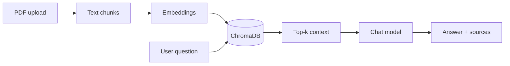

# Document AI Assistant (RAG)

Upload **PDF** files and ask questions. This is your **AI Application Engineer** portfolio piece: FastAPI, embeddings, ChromaDB, and an LLM — deployable with Docker on AWS.

## Flow



## Setup

```bash
python -m venv .venv
.venv\Scripts\activate
pip install -r requirements.txt
cp .env.example .env
# Edit .env — add OPENAI_API_KEY
uvicorn app.main:app --reload
```

**Web UI:** http://127.0.0.1:8000/ (after `uvicorn` is running)  
**API docs:** http://127.0.0.1:8000/docs

> **Note:** There is no public cloud URL yet — GitHub only hosts the **source code**.  
> Portfolio explain page (after GitHub Pages is on):  
> https://saswatsomyasahu.github.io/saswat/demos/document-ai-assistant/

## Try it

1. `POST /documents/upload` — attach a PDF (e.g. a public syllabus or your own notes).
2. `POST /chat` — JSON body: `{ "question": "What is ...?" }`

Without `OPENAI_API_KEY`, `/health` still works; `/chat` returns 503 with instructions.

## Docker

```bash
cp .env.example .env
docker compose up --build
```

## Ideas to extend (good for interviews)

- Student MIS **FAQ bot** over admission PDFs (your domain).
- Rate limiting and API key auth for production.
- Swap Chroma for **pgvector** on RDS when you practice AWS.

## Author

Saswat Somya Sahu — complements NIELIT ML/OMR and IoT dashboard experience with modern LLM RAG.
